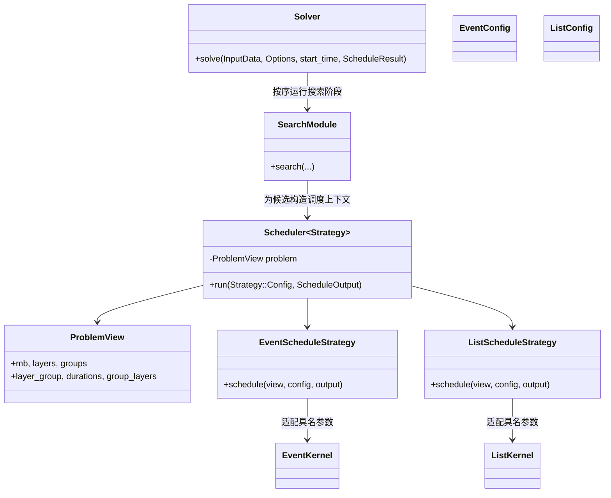

# 调度接口与求解流程的设计

本文说明当前工程中的调度参数对象、编译期策略、内核适配和求解门面。设计沿用现有 C++17 模块边界，不改变调度算法、候选次序、比较规则或时间预算。

可结合[当前整体架构图](../.archify/architecture-suite-20261031-030904/architecture/index.html)查看调用边界，并通过[4+1 视图说明](architecture-4-plus-1.md)了解这些设计角色与领域模型、模块组织及运行进程的对应关系。

## 参与者与依赖

| 设计角色 | 工程中的参与者 | 职责 |
|---|---|---|
| 参数对象 | `scheduling::ProblemView`、`EventConfig`、`ListConfig`、`ScheduleOutput`，位于 `src/scheduling/schedule_api.hpp` | 用字段名表达问题输入、策略选项和输出位置。问题视图保存大向量的只读引用，构造时不复制调度数据。 |
| 静态策略 | `Scheduler<Strategy>`、`EventScheduleStrategy`、`ListScheduleStrategy`，位于 `schedule_api.hpp` | 搜索调用以模板实参选择具体策略，`Scheduler::run` 按共同约定转发问题视图、配置和输出。该结构不使用虚函数继承或运行期多态。 |
| 适配器 | `event_scheduler.cpp`、`list_scheduler.cpp` 中的具体策略 | 把具名配置转换为成熟调度内核原有的位置参数次序，内核继续负责调度计算。 |
| 门面 | `solver::Solver::solve`，位于 `src/app/solver.hpp/.cpp` | 按原顺序编排搜索阶段并把最终结果写入调用方提供的结果对象。`solver::run` 负责解析输入选项、处理错误和序列化输出。 |

`ScheduleOutput` 借用调用方持有的操作向量和 makespan；列表内核需要的 starts/ends 仍是可选输出引用。事件与列表调度都使用 `src/model/scheduled_operation.hpp` 中的 `solver::ScheduledOperation` 类型别名，因此列表调度可直接写入搜索、校验和 incumbent 使用的同一操作向量，不再逐项转换，也不产生额外的候选操作数组。

策略会在搜索候选循环中对每个待调度候选转发一次完整的调度调用。策略选择位于整个调度边界；内核推进节点、事件和优先队列时仍运行原算法，没有新增节点级策略派发或虚调用。

列表搜索保持各自原有的筛选顺序：`list_search` 先用列表内核返回的 makespan 判断是否值得继续，再进行现有内存安全检查；`wave_search` 则在列表调度后按原流程直接执行其安全检查。两条路径都共用操作向量，没有插入逐 operation 转换。

## 策略约定与扩展

策略提供自己的 `Config` 类型和静态函数 `schedule(const ProblemView&, const Config&, ScheduleOutput&)`。`Scheduler<Strategy>` 保存轻量问题视图，并将 `run(config, output)` 转交给 `Strategy::schedule`。接口无需运行期策略查找或额外分配。

第三个策略的接口替身及其实际编译、运行检查见 [`scripts/test_strategy_api.cpp`](../scripts/test_strategy_api.cpp)。该测试验证自定义 `Config` 与 `schedule` 能经 `Scheduler<TestStrategy>` 被调用；它不构造合法调度表，也不替代官方验收。增加正式策略时，应保证结果满足调用方要求的 operation 完整性、顺序与平局处理规则。

## 门面边界与计时

`Solver::solve(const InputData&, const Options&, steady_clock::time_point, ScheduleResult&)` 接收已解析输入和选项、原始绝对计时起点以及调用方结果引用。无可行配置时返回 `false`；成功时把最终结果移动到调用方对象。`run` 在解析选项之前记录计时起点，随后读取输入、调用门面、报告无解错误并序列化结果。

门面保持原有阶段顺序、供 scale v8 使用的 v7 incumbent 快照和现有结果移动/复制位置；没有新增一份完整的 `ScheduleResult` 包装副本。

## 性能约束

- 保持问题视图与配置为轻量值/引用对象；构造接口时不复制 durations、group 向量或调度结果。
- 适配只发生在完整调度调用边界，不在节点、事件或候选队列内引入策略派发。
- 保持 `list_search` 的 makespan 提前筛选和随后安全检查顺序；`wave_search` 保持自己的原校验流程。不要为列表结果增加每候选一次的全量转换。
- 保持事件/列表内核的位置参数顺序与原有默认行为。
